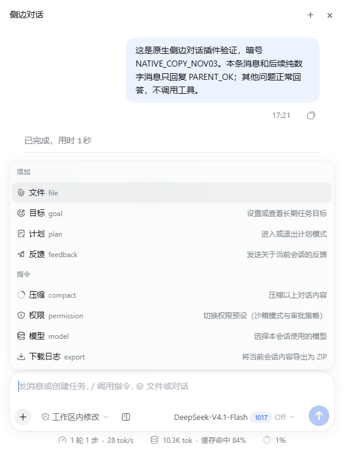
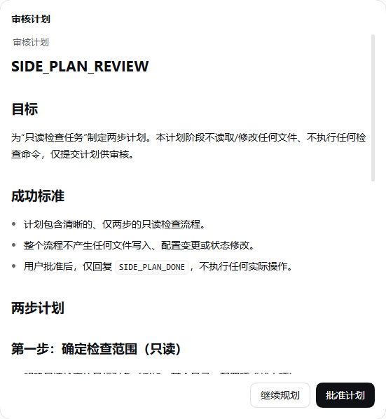
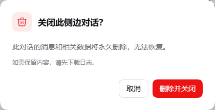

<div align="center">


# DSH Side Chat

**Keep the main task moving. Ask a follow-up on the side.**

Codex-style `/side` conversations for DeepSeek Harness.

<p>
  <a href="https://github.com/qiaozheng9/dsh-side-chat/releases/latest"></a>
  <a href="#install"></a>
  <a href="#install"></a>
  <a href="LICENSE"></a>
</p>

[简体中文](README.md) · **English**

[Features](#features) · [Install](#install) · [Usage](#usage) · [FAQ](#faq) · [Changelog](CHANGELOG.md)

</div>

Your main chat is implementing a feature, but you want to understand a design choice, inspect some code, or explore another approach. Enter `/side` to open an independent conversation beside it, with the context captured when it opens.

Each side chat has its own messages, model and permissions. Attach reference files, discuss a plan, or keep several side conversations open at once.

## Features

| Feature | What you can do |
| --- | --- |
| **Contextual follow-ups** | Start with the main chat's context, or select text in its transcript and ask about that passage. |
| **Independent models and permissions** | Use native DSH controls to choose the model, reasoning effort and permission preset for this side chat. |
| **Reference materials** | Add files, images and local folder references to the current side chat. |
| **Goals and plans** | Create, edit, pause and resume goals; enter plan mode and review the submitted plan in the side panel. |
| **Multiple tabs** | Keep separate discussions open for different questions. |
| **Compaction and export** | Compact the current side chat or download its new messages, execution logs and referenced attachments as a ZIP. |
| **Temporary conversations** | Confirm before permanently deleting a side chat. Download its logs first if you want to keep a copy. |

### Native DSH controls

The composer, model picker and permission controls follow DSH's native interface. The **＋** menu brings together attachments, goals, plans, compaction, permissions, models and log export.

<p align="center">
  
</p>

<table>
  <tr>
    <td width="56%" valign="top">
      <strong>Review plans in context</strong><br /><br />
      Read the proposed plan, approve it, or leave feedback and keep planning.<br /><br />
      
    </td>
    <td width="44%" valign="top">
      <strong>Confirm before cleanup</strong><br /><br />
      Cancel to keep the conversation. Failed deletion retains the panel so you can retry.<br /><br />
      
    </td>
  </tr>
</table>

## Install

> [!IMPORTANT]
> The complete supported setup is **Windows · DSH Desktop `0.2.1-rc.5`**. First install and enable [dsh-delete-session](https://github.com/qiaozheng9/dsh-delete-session#安装) using its documented setup, including the required Desktop application adaptation. It provides permanent cleanup when a side chat closes.

Run in PowerShell:

```powershell
dsh plugin --profile desktop add https://github.com/qiaozheng9/dsh-side-chat/releases/download/v0.1.11/dsh-side-chat-0.1.11.tgz
```

**Restart DSH, then enter `/side` in the main chat.** This is a prebuilt package; installing it requires no local compilation.

Disable another `/side` provider before enabling this one. Other DSH versions, standalone Web deployments and operating systems have not completed end-to-end validation.

## Usage

Enter either command in the **main chat composer**:

```text
/side
```

```text
/side Explain the tradeoffs in that approach. What alternatives should I consider?
```

You can also select text in the main transcript and choose **Ask in side chat**.

- Use the model and permission controls beneath the side-chat input to configure that conversation.
- Use **＋ → File / Folder** to add reference materials, including images through the file picker.
- Use **＋ → Goal** to manage a goal, or **＋ → Plan** to enter or leave plan mode.
- Use **＋** in the side-panel header to start another side chat.
- Use **＋ → Download logs** before closing if you want to retain the results.

Choosing **Delete and close** stops the side activity and permanently cleans up its conversation data. Cancelling keeps it open.

## FAQ

**Does this change the main chat?** Each side chat handles its own messages, model, permissions, goals and plan state. It starts with a snapshot of the main chat's context at opening.

**Why does closing fail?** Check that dsh-delete-session is installed and enabled in the same `desktop` profile. Failed cleanup keeps the panel open for retry.

**What is exported?** The ZIP contains this side chat's new messages, execution logs and referenced attachments. Inherited main-chat history and other side chats are excluded. The ZIP is for reading and diagnostics, not session restoration.

**Are my project files deleted?** Referenced project files and shared data are retained. Cleanup removes the side conversation and its exclusively owned data.

**Can I install from npm or the GitHub main branch?** Use the prebuilt GitHub Release above. The main branch contains development source and does not automatically build runtime files during installation. See the [development guide](docs/development.md) to build locally.

## Feedback and contributions

[Open an issue](https://github.com/qiaozheng9/dsh-side-chat/issues) with the DSH and plugin versions, reproduction steps and relevant screenshots. Check logs for sensitive information before sharing them.

See the [development guide](docs/development.md) for build and validation commands, and the [changelog](CHANGELOG.md) for release history.

## Credits and license

The side-conversation core was extracted from [Better Sidebar](https://github.com/omdsh-dev/DSH-better-sidebar). The interaction is inspired by Codex `/side`.

[MIT License](LICENSE) · [Attribution](NOTICE.md)
