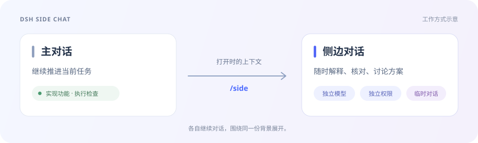
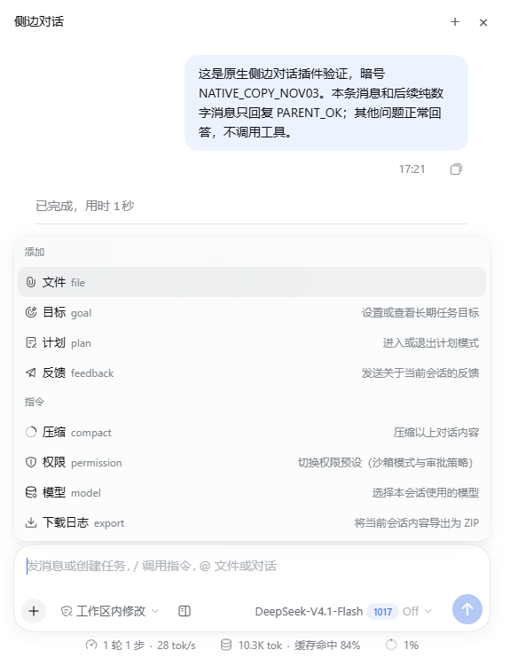
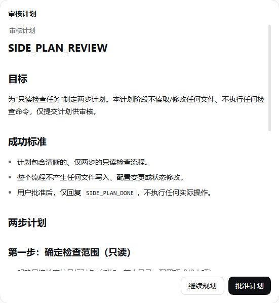
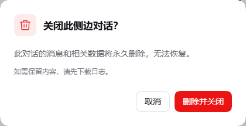

<div align="center">


# DSH Side Chat

**主对话继续做事，侧边对话随时追问。**

把 Codex 风格的 `/side` 带到 DeepSeek Harness。

<p>
  <a href="https://github.com/qiaozheng9/dsh-side-chat/releases/latest"></a>
  <a href="#安装"></a>
  <a href="#安装"></a>
  <a href="LICENSE"></a>
</p>

**简体中文** · [English](README.en.md)

[功能](#功能) · [安装](#安装) · [使用](#使用) · [常见问题](#常见问题) · [更新记录](CHANGELOG.md)

</div>

主对话正在实现功能，你想先弄清一个技术选择、检查一段代码，或者讨论另一种方案？在主对话输入 `/side`，就能在右侧打开一个带有当前上下文的独立对话。

侧边对话有自己的消息、模型和权限。你可以继续追问、添加文件、制定计划，也可以同时打开多个侧边对话。

<p align="center">
  
</p>

## 功能

| 功能 | 你可以做什么 |
| --- | --- |
| **带上下文的追问** | 打开时继承主对话的上下文；也可选中主对话中的文字，直接在侧边询问。 |
| **独立的模型与权限** | 使用 DSH 原生选择器切换模型、推理等级和权限，设置仅作用于当前侧边对话。 |
| **文件、图片与文件夹** | 为当前侧边对话添加参考材料，让它围绕具体内容回答。 |
| **目标与计划** | 创建、编辑、暂停或继续目标；进入计划模式，在侧边审核模型提交的计划。 |
| **多标签对话** | 同时保留多个侧边讨论，分别处理不同问题。 |
| **压缩与日志导出** | 压缩当前侧边的上下文，或将它的消息、执行日志及引用附件下载为 ZIP。 |
| **关闭后清理** | 关闭前确认，确认后永久删除该临时对话。需要保留内容时，先下载日志。 |

### 熟悉的 DSH 操作

输入框、模型和权限控件沿用 DSH 的原生样式。点击 **＋**，文件、文件夹、目标、计划、压缩、权限、模型和日志下载都在这里。

<p align="center">
  
</p>

### 计划在侧边审核，关闭前明确确认

<table>
  <tr>
    <td width="56%" valign="top">
      <strong>计划审核</strong><br /><br />
      查看模型提交的计划，选择批准，或补充意见继续规划。<br /><br />
      
    </td>
    <td width="44%" valign="top">
      <strong>临时对话清理</strong><br /><br />
      关闭前提示不可恢复；取消会保留对话，删除失败时也会保留并允许重试。<br /><br />
      
    </td>
  </tr>
</table>

## 安装

> [!IMPORTANT]
> 当前完整支持 **Windows · DSH Desktop `0.2.1-rc.5`**。请先按 [dsh-delete-session 的安装说明](https://github.com/qiaozheng9/dsh-delete-session#安装)安装并启用删除服务，再安装本插件。该服务负责关闭后的永久清理，安装过程包含它所需的桌面程序适配。

在 PowerShell 中执行：

```powershell
dsh plugin --profile desktop add https://github.com/qiaozheng9/dsh-side-chat/releases/download/v0.1.12/dsh-side-chat-0.1.12.tgz
```

**重启 DSH，然后在主对话输入 `/side`。** 发行包已预构建，安装本插件无需在本机编译。

如果已启用其他插件的 `/side` 功能，请先停用同名入口，避免命令冲突。其他 DSH 版本、独立 Web 部署及其他操作系统尚未完成端到端验证。

## 使用

### 1. 打开侧边对话

在**主对话输入框**输入：

```text
/side
```

也可以直接带上问题：

```text
/side 解释一下刚才这个方案的取舍，还有哪些替代方案？
```

选中主对话中的一段文字，点击 **「在侧边对话中询问」**，即可围绕选中的内容继续讨论。

### 2. 按当前问题选择工具

- 点击输入框下方的模型或权限控件，设置当前侧边对话。
- 点击 **＋ → 文件／文件夹**，添加参考材料；图片也可以通过文件入口添加。
- 点击 **＋ → 目标** 管理长期目标，或通过 **＋ → 计划** 进入、退出计划模式。
- 点击侧边顶部的 **＋**，再开一个独立讨论。

### 3. 保留结果，再关闭

需要留存时，先点击 **＋ → 下载日志**。关闭侧边对话时，选择 **「删除并关闭」** 会停止相关侧边活动并清理该对话的数据；选择取消则继续保留。

## 常见问题

<details>
<summary><strong>会改变主对话或其他侧边对话吗？</strong></summary>

侧边消息独立处理，模型、权限、目标和计划操作只作用于当前侧边对话。上下文取自打开时的主对话快照。

</details>

<details>
<summary><strong>为什么关闭时提示删除失败？</strong></summary>

请确认 [dsh-delete-session](https://github.com/qiaozheng9/dsh-delete-session#安装) 已按其文档完成安装，并在同一个 `desktop` profile 中启用。删除没有成功时，面板会保留，方便处理后重试。

</details>

<details>
<summary><strong>下载的日志包含哪些内容？</strong></summary>

ZIP 包含当前侧边新增的消息、执行日志及其引用附件，不打包继承的主对话历史或其他侧边对话。它用于阅读和诊断，不是 DSH 会话恢复包。

</details>

<details>
<summary><strong>关闭会删除我添加的项目文件吗？</strong></summary>

会话清理会保留你引用的项目文件和共享数据，清理的是该侧边对话的消息及相关独占数据。确认删除后，对话内容无法通过本插件恢复。

</details>

<details>
<summary><strong>可以从 npm 或 GitHub 源码直接安装吗？</strong></summary>

目前请使用上方的 **GitHub Release 预构建包**。主分支存放开发源码，直接安装 GitHub 主分支不会自动生成运行文件。自行构建的步骤见 [开发文档](docs/development.md)。

</details>

## 反馈与贡献

遇到问题时，请在 [Issues](https://github.com/qiaozheng9/dsh-side-chat/issues) 提供 DSH 版本、插件版本、复现步骤及相关截图；日志请先确认不含敏感内容。

欢迎提交改进。[开发文档](docs/development.md)包含构建、验证与代码入口，[更新记录](CHANGELOG.md)列出各版本变化。

## 致谢与许可

侧边对话核心提取自 [Better Sidebar](https://github.com/omdsh-dev/DSH-better-sidebar)，交互参考 Codex `/side`。感谢上游项目。

[MIT License](LICENSE) · [来源与版权说明](NOTICE.md)
